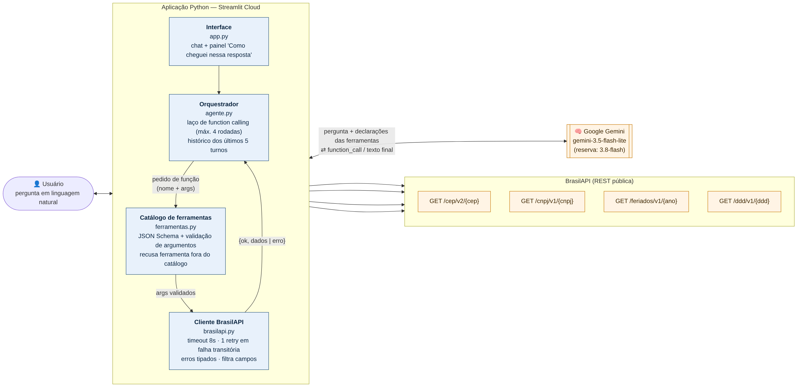
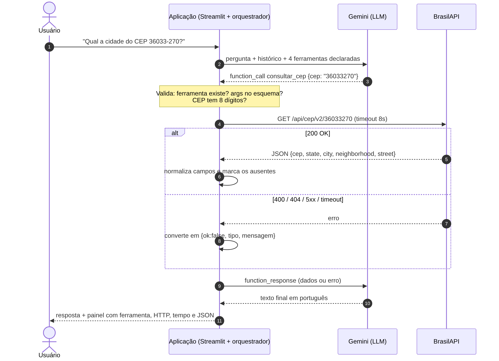

# 🇧🇷 Assistente BrasilAPI — Integração com IA & Agentes

Atividade integradora do semestre — Integração de Software · UniAcademia.

Aplicação que recebe uma pergunta em **linguagem natural**, usa o **Google Gemini** para interpretar a intenção, deixa a **aplicação** escolher, validar e executar a ferramenta certa contra a **BrasilAPI** (consulta real, sem mocks) e devolve uma resposta organizada, com **tratamento de erros**.

**App online:** _LINK_DO_STREAMLIT_  
**Vídeo de demonstração:** _LINK_DO_VIDEO_

## Como os requisitos foram atendidos

| Requisito | Onde está |
|---|---|
| Interface simples de interação | `app.py` — chat Streamlit com exemplos clicáveis |
| LLM interpretando a solicitação | `assistente/agente.py` — Gemini com function calling |
| Ferramenta de consulta a API externa | `assistente/brasilapi.py` — 4 endpoints da BrasilAPI |
| Seleção de ferramenta pela aplicação | `assistente/ferramentas.py` — catálogo fechado, validação de argumentos, execução só pelo backend |
| Consulta real, sem mocks | `requests.get` direto em `https://brasilapi.com.br/api/...` (mocks só existem nos testes automatizados) |
| Processamento do retorno | normalização de campos, marcação de campos ausentes, filtro do JSON do CNPJ, amostra de cidades do DDD |
| Resposta compreensível | resposta em português + painel "Como cheguei nessa resposta" (ferramenta, argumentos, HTTP, tempo, JSON) |
| Tratamento de erros | erros tipados da API e do LLM, timeout com nova tentativa, modelo reserva, limite de rodadas |

## Ferramentas disponíveis ao modelo

| Ferramenta | Endpoint | Exemplo de pergunta |
|---|---|---|
| `consultar_cep(cep)` | `GET /api/cep/v2/{cep}` | "Qual o bairro do CEP 36033-270?" |
| `consultar_cnpj(cnpj)` | `GET /api/cnpj/v1/{cnpj}` | "Dados do CNPJ 19.131.243/0001-97" |
| `consultar_feriados(ano)` | `GET /api/feriados/v1/{ano}` | "Qual o próximo feriado nacional?" |
| `consultar_ddd(ddd)` | `GET /api/ddd/v1/{ddd}` | "Que estado usa o DDD 32?" |

## Arquitetura





Princípio seguido (slides 14 e 21): **o LLM decide ou sugere a ferramenta; a aplicação controla a execução.** O modelo nunca chama a API diretamente — ele devolve um pedido de função (`function_call`), e o backend:

1. recusa ferramenta que não está no catálogo (`ferramenta_nao_autorizada`);
2. valida os argumentos contra o JSON Schema declarado (`argumento_invalido`);
3. valida o formato (CEP 8 dígitos, CNPJ 14, DDD 2, ano 1900–2199) **antes** de gastar uma requisição;
4. executa a chamada HTTP e devolve ao modelo `{ok: true, dados}` ou `{ok: false, erro: {tipo, mensagem}}`.

`automatic_function_calling` do SDK está **desligado** de propósito: quem executa é o nosso código, não o SDK.

## Tratamento de erros (slide 29)

| Situação | Como é tratada |
|---|---|
| CEP/CNPJ/DDD com formato errado | `entrada_invalida`, sem chamar a API; o modelo pede correção |
| CEP/CNPJ não encontrado (404) | `nao_encontrado` com a mensagem da própria API |
| API indisponível (5xx) | `api_indisponivel`, 1 nova tentativa |
| Timeout (8 s) / falha de conexão | `timeout` / `erro_conexao`, 1 nova tentativa |
| Resposta incompleta (bairro/rua ausentes) | campos `null` + lista `campos_ausentes`; o modelo é instruído a não inventar |
| Resposta sem campos essenciais ou não-JSON | `resposta_invalida` |
| Pergunta sem o parâmetro (ex.: "meu endereço") | o modelo pede o dado; nenhuma ferramenta é chamada |
| Cota do Gemini (429) / modelo indisponível | tenta o modelo reserva; se falhar, mensagem clara |
| Chave do Gemini inválida | mensagem clara, sem tentar o reserva |
| Modelo entra em loop pedindo ferramentas | limite de 4 rodadas |
| Bug inesperado numa ferramenta | `erro_interno`, a conversa continua |

## Rodando localmente

```bash
python -m venv .venv
source .venv/bin/activate          # Windows: .venv\Scripts\activate
pip install -r requirements-dev.txt
cp .streamlit/secrets.toml.example .streamlit/secrets.toml   # e cole sua chave
streamlit run app.py
```

A chave é gratuita em <https://aistudio.google.com/apikey>. Modelos configuráveis por `GEMINI_MODEL` e `GEMINI_MODEL_RESERVA`.

## Testes

```bash
pytest -q
```

37 testes cobrem o cliente HTTP (sucesso, 400, 404, 5xx, timeout com retry, JSON inválido, resposta incompleta), a validação do catálogo de ferramentas e o laço do agente (fluxo completo, ausência de parâmetro, limite de rodadas, fallback de modelo, chave inválida). Nos testes, a rede e o Gemini são substituídos por respostas roteirizadas; **a aplicação em execução sempre consulta a BrasilAPI e o Gemini reais.**

## Limitações conhecidas

- O limite de 25 perguntas por sessão protege a cota gratuita, mas recarregar a página zera o contador. Em produção seria preciso limite por IP/usuário no servidor.
- No plano gratuito do Gemini, o Google pode usar as entradas para melhorar os produtos: não digite dados pessoais.
- A BrasilAPI é um serviço comunitário sem SLA; instabilidades aparecem como `api_indisponivel`/`timeout`.

## Estrutura

```
app.py                     interface Streamlit
assistente/agente.py       orquestração LLM ⇄ ferramentas
assistente/ferramentas.py  catálogo, esquemas e validação
assistente/brasilapi.py    cliente HTTP da BrasilAPI
tests/                     testes automatizados (pytest)
docs/                      diagramas (Mermaid + PNG)
```
